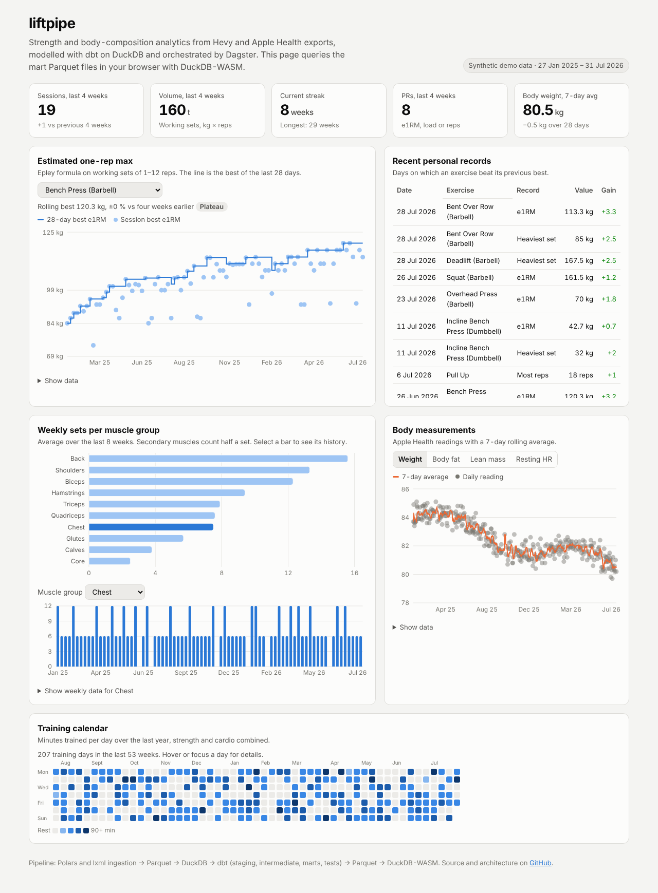
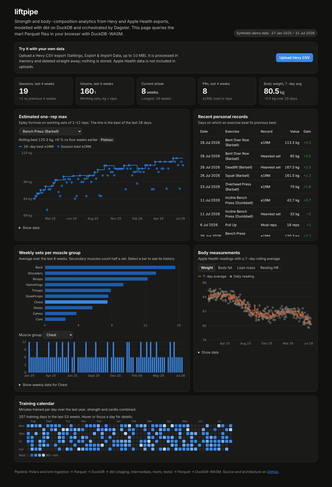
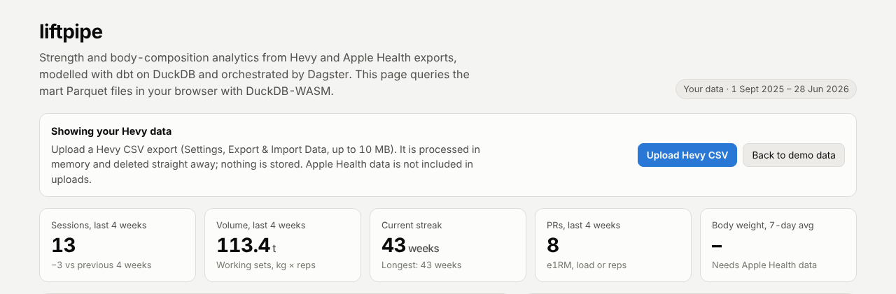
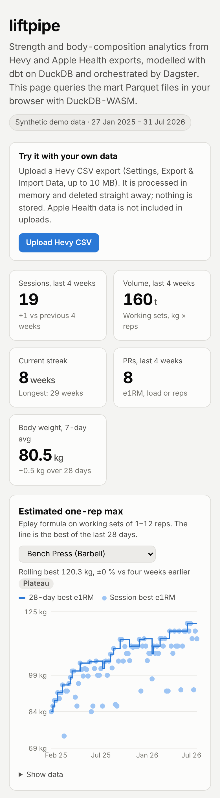
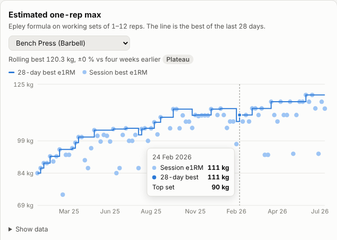
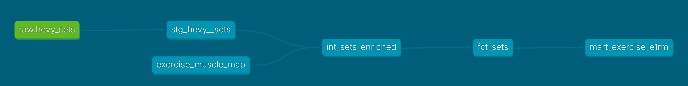
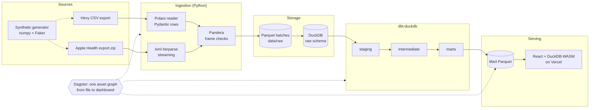
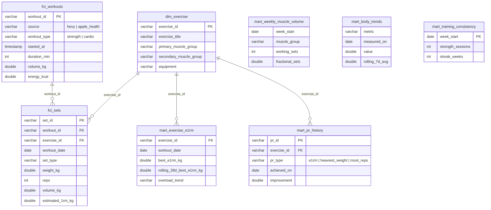

# liftpipe

[](https://github.com/Sam-Razavi/liftpipe/actions/workflows/ci.yml)

A free-to-run data pipeline for strength training. It ingests Hevy workout exports and Apple Health body data, models them with dbt on DuckDB, orchestrates everything with Dagster, and serves a static dashboard that queries the marts in the browser with DuckDB-WASM.

**Live demo:** https://liftpipe.vercel.app (synthetic data, no personal information). Visitors can also upload their own Hevy CSV and see their dashboard, served by the [upload API](#upload-api) on Railway (`https://api-production-76cc.up.railway.app`).

The pipeline is the product. There is no logging UI: you keep training in Hevy and export when you like.



## What it shows

| Question | Mart |
| --- | --- |
| How many hard sets does each muscle group get per week? | `mart_weekly_muscle_volume` |
| Is my estimated 1RM still rising, flat or falling? | `mart_exercise_e1rm` |
| When did I set each personal record, and by how much? | `mart_pr_history` |
| What is my weight and body-fat trend once daily noise is smoothed? | `mart_body_trends` |
| How consistently do I train, and how long is my streak? | `mart_training_consistency` |

## Screenshots

All taken from the [live demo](https://liftpipe.vercel.app), which runs on synthetic data.

**Dark mode.** The palette is defined as design tokens, with its own dark steps rather than an automatic inversion; it follows the system setting.



**Bring your own data.** After uploading a Hevy CSV (here an imperial-unit export, converted to kilograms on ingestion) the same page shows the visitor's own history. Body weight reads "Needs Apple Health data" because uploads cover Hevy only.



**Phone and detail.** The layout works at 390 px wide with no horizontal scrolling. Charts have hover tooltips and a "Show data" table underneath for exact values.

<table>
  <tr>
    <td valign="top"></td>
    <td valign="top"></td>
  </tr>
</table>

**Lineage in dbt.** The generated dbt docs trace a mart back to its source: `raw.hevy_sets` is staged, joined to the muscle-group seed, then flows through the set fact table to `mart_exercise_e1rm`.



## Architecture



Dagster sees one lineage graph: the ingestion assets are named after the dbt sources (`raw/hevy_sets`, `raw/health_records`, `raw/health_workouts`), so dagster-dbt wires them upstream of the staging models, and every dbt test becomes an asset check.

## Data model



| Layer | Models | Materialisation |
| --- | --- | --- |
| raw | `hevy_sets`, `health_records`, `health_workouts` (+ `_ingest_log`) | DuckDB tables, primary keys on natural keys |
| staging | `stg_hevy__sets`, `stg_hevy__workouts`, `stg_apple_health__body_measurements`, `stg_apple_health__workouts` | views; types, units (lb→kg, fraction→%), renames |
| intermediate | `int_sets_enriched` (muscle groups, volume, Epley e1RM), `int_body_daily` (latest reading per day) | views |
| marts | `dim_exercise`, `fct_sets` (incremental), `fct_workouts`, five analytics marts | tables, exported to Parquet |

## Quick start

Requirements: [uv](https://docs.astral.sh/uv/), Node 22 and `make`.

```bash
make setup   # Python 3.12 environment and dashboard dependencies
make demo    # synthetic exports -> Dagster run (ingest, dbt build, export)
make dashboard   # http://localhost:5173
```

`make api` serves the [upload API](#upload-api) at http://localhost:8000. `make dagster` opens the Dagster UI at http://localhost:3000 with the full asset graph, a `refresh_all` job, a nightly schedule and a sensor that triggers on new export files (both off by default).

### Running on your own data

1. Hevy: *Settings → Export & Import Data → Export Workouts*. Save the CSV in `data/real/hevy/`.
2. Apple Health: *Profile → Export All Health Data*. Save `export.zip` in `data/real/apple_health/`.
3. `make real`

`data/real/` is git-ignored. Drop new exports next to old ones whenever you like; overlapping history is de-duplicated.

### Make targets

| Target | What it does |
| --- | --- |
| `make demo` | Generate synthetic data and run the whole pipeline through Dagster |
| `make real` | Same pipeline on `data/real/` |
| `make ingest` / `make dbt` / `make export` | Run one stage on its own |
| `make test` / `make lint` | pytest; ruff lint and format checks |
| `make dagster` | Dagster UI |
| `make api` | Upload API with interactive docs at `/docs` |
| `make dashboard` / `make dashboard-build` | Vite dev server; production build |
| `make clean` | Remove generated data, warehouse and dbt artefacts |

## Upload API

A small FastAPI service turns an uploaded Hevy CSV into the same mart Parquet files the demo uses, so a visitor can see their own dashboard without an account.

```bash
make api
curl -F "file=@workouts.csv" localhost:8000/v1/dashboards -o dashboard.zip
```

It reuses the batch pipeline rather than reimplementing it: `read_hevy_csv`, Pandera, the raw store, the unchanged dbt project and `export_marts`, run against a throwaway DuckDB file. Uploads are held in a temporary folder deleted before the response is sent, never logged and never persisted. Limits: 10 MB per file, 10 builds per client per hour, one concurrent build per worker. A 5,800-set export (18 months) takes about 6.5 s, almost all of it `dbt build`; the dbt parse is done once at start-up. Errors are specific: `400` for a file that is not a Hevy export (with the failing row), `413` too large, `422` for data that fails a quality check, `429` over quota.

The dashboard shows an upload panel when `VITE_API_URL` is set, unzips the response in the browser with fflate and swaps the Parquet files into DuckDB-WASM. Design notes, configuration and deployment steps: [docs/phase-2-upload-api.md](docs/phase-2-upload-api.md).

## Design decisions

**Natural keys, because the exports have no IDs.** A Hevy workout is keyed by the hash of its start time (it survives renaming the workout in the app); a set by workout, exercise position and set index (position, not title, so the same exercise twice in one workout cannot collide). Apple Health records are keyed by type, source, start, end, value and unit.

**Idempotent, incremental loads.** Each export is a full-history snapshot. Ingestion skips files whose SHA-256 is already in `raw._ingest_log`, and upserts by primary key, so the newest export wins for edited rows. With the synthetic data, loading a second export four weeks after the first adds 333 of its 5,788 sets; re-running adds nothing. `fct_sets` is an incremental dbt model on the raw load timestamp, and muscle groups live on `dim_exercise`, so editing the muscle map never needs a full refresh.

**Streaming XML.** Apple Health exports are often several gigabytes. The parser uses `lxml.etree.iterparse` filtered to `Record` and `Workout`, clearing each element and its processed siblings. On a 109 MB export it grows the process by 27 MB, against 1,047 MB for a full-tree parse; a test asserts growth stays under half the file size.

**Validation at the edge.** Pydantic validates every row (types, ranges, `end_time >= start_time`, set types) and rejects a file with the offending row number. Pandera then checks frame-level properties (key uniqueness, categories, ranges) before anything is persisted. dbt tests cover keys, nulls, relationships, accepted values and ranges in every layer.

**Timezones.** Hevy writes local wall-clock time; Apple Health writes local time with a UTC offset (`+0100` in winter, `+0200` in summer). Both are stored as naive local timestamps, with Apple's offset kept in its own column, so a Hevy session and the watch workout recorded alongside it line up and are merged in `fct_workouts`.

**No server for the dashboard.** The marts are exported as Parquet (about 90 kB in total) and queried in the browser with DuckDB-WASM. Hosting is a free static site.

**Swappable source.** Ingestion sits behind a `WorkoutSource` protocol. The Hevy REST API (Pro-only, v0.0.1) can be added as a second implementation that returns the same frame, without touching storage, dbt or the dashboard.

## Testing and CI

* **pytest (49 tests):** the upload API (valid, invalid, oversize, rate-limited and cross-origin requests), generator determinism and format fidelity, Hevy parsing (units, timestamps, invalid rows), Apple Health parsing (zip input, legacy and iOS 16+ workout statistics, bounded memory), idempotent loads, Dagster lineage and sensor, and an end-to-end ingest → dbt build → export test that reconciles marts with raw counts.
* **dbt (75 data tests, 2 unit tests):** generic `unique`, `not_null`, `relationships`, `accepted_values`, plus project tests `accepted_range` and `unique_combination`; singular tests for plausible body metrics, e1RM never below the lifted weight, and a warning when unmapped exercises exceed 10 % of sets. Unit tests pin the Epley maths and the latest-reading rule.
* **GitHub Actions:** ruff, pytest, `make demo` on synthetic data, a build of the API container with a real upload against it, dbt docs as an artefact, and a typecheck and build of the dashboard.

Real data never enters the repository. CI and the live demo use `python -m liftpipe.synthetic`, which writes 78 weeks of push/pull/legs training with progressive overload, deloads, missed weeks and warm-ups, plus Apple Health body data with a slow recomposition trend, in the exact export formats.

## Project structure

```
src/liftpipe/
  synthetic/       generators for Hevy CSV and Apple Health XML
  ingest/          readers, natural keys, Parquet and DuckDB raw store
  quality/         Pandera schemas
  orchestration/   Dagster assets, dbt integration, job, schedule, sensor
  api/             FastAPI upload service (Phase 2)
  export.py        marts -> dashboard/public/data/*.parquet
dbt/liftpipe/      staging, intermediate and marts models, seed, tests, macros
dashboard/         React, TypeScript, Vite, Recharts, DuckDB-WASM
tests/             pytest suite
Dockerfile         Upload API image (Railway)
```

## Roadmap

* Hevy API connector as an optional second `WorkoutSource` (the API is Pro-only and still v0.0.1).
* Apple Health uploads, if a lightweight way to accept multi-gigabyte exports emerges.

## Limitations

* Workouts deleted in Hevy stay in the warehouse, because exports carry no deletion markers. Rebuild from the latest export to drop them.
* Muscle groups come from a hand-maintained seed. Custom exercises fall into `other` until added to `dbt/liftpipe/seeds/exercise_muscle_map.csv`.
* Uploads cover Hevy only, so body measurements show no data in upload mode.
* The rate limiter is in memory, so quotas are per process and reset on restart.
* Epley overestimates 1RM for high-rep sets, so e1RM uses sets of 1-12 reps only.
