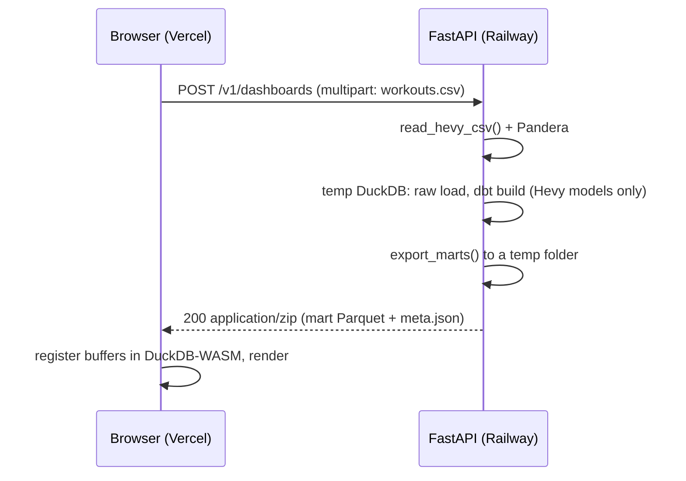

# Phase 2: "Upload your Hevy CSV" API

Status: built. Code in `src/liftpipe/api/`, tests in `tests/test_api.py`, UI in `dashboard/src/upload.ts` and `dashboard/src/components/UploadPanel.tsx`.

## Goal

Let a visitor upload their own Hevy CSV on the live demo and see their dashboard, without an account and without storing their data.

## Shape

The dashboard already reads Parquet buffers, so the only front-end change is a file input and a code path that registers the returned files instead of fetching `/data/*.parquet`.

## Endpoint

| | |
| --- | --- |
| `POST /v1/dashboards` | `multipart/form-data`, field `file`, max 10 MB |
| `200` | `application/zip` containing the mart Parquet files and `meta.json` |
| `400` | Not a Hevy export (`HevyFormatError` message, including the failing row) |
| `413` | File too large |
| `429` | Rate limit (per IP, e.g. 10 per hour) |
| `GET /healthz` | Liveness |

## Implementation notes

* **Reuse, do not fork.** The handler calls `liftpipe.ingest.hevy_csv.read_hevy_csv`, `liftpipe.ingest.raw_store.persist` and `liftpipe.export.export_marts`, and runs dbt with `dbtRunner` against a per-request DuckDB file in a `TemporaryDirectory`.
* **Hevy-only data, full project.** The whole dbt project still builds; the Apple Health tables are created empty, so `mart_body_trends` has no rows and the dashboard says why. dbt runs as a subprocess with the work folder as its working directory, so concurrent requests cannot see each other's DuckDB file.
* **Parse once.** dbt re-parses the project on every invocation (about 5 s). The service parses once at start-up and seeds each request's target folder with the partial-parse file. dbt discards that cache if the rendered profile changes, so the warehouse path is the constant `warehouse.duckdb` relative to each request's work folder. Per-request dbt unit tests are skipped (CI runs them); data tests still run, and a failure returns `422`.
* **Measured latency.** About 6.5 s for 18 months of training (5,800 sets) on a 2-vCPU sandbox: roughly 0.5 s for reading and loading, 6 s for `dbt build`. Parsing cost is paid once per process.
* **Privacy.** Nothing is written outside a `TemporaryDirectory`, which is removed before the response is sent. File contents are never logged. The upload form says so.
* **Limits.** 10 MB per file (checked from `Content-Length` and again while reading), 10 builds per client per hour (in-memory sliding window, so per process), one concurrent build per worker with a 30 s queue before `503`. Scale with replicas rather than threads.
* **CORS.** Only the origins in `LIFTPIPE_CORS_ORIGINS` (default: local dev servers).
* **Client address.** With `LIFTPIPE_TRUST_PROXY=1` (set in the image) the rate limiter uses the last `X-Forwarded-For` entry, which is the address Railway's proxy saw. Do not enable it when the service is directly reachable.

## Configuration

| Variable | Default | Meaning |
| --- | --- | --- |
| `LIFTPIPE_CORS_ORIGINS` | `http://localhost:5173,http://localhost:4173` | Comma-separated allowed origins |
| `LIFTPIPE_MAX_UPLOAD_MB` | `10` | Largest accepted file |
| `LIFTPIPE_RATE_LIMIT_PER_HOUR` | `10` | Builds per client per hour |
| `LIFTPIPE_MAX_CONCURRENT_BUILDS` | `1` | Parallel builds per process |
| `LIFTPIPE_TRUST_PROXY` | unset (`1` in the image) | Read the client from `X-Forwarded-For` |
| `PORT` | `8000` | Set by Railway |

## Deploying

1. **Railway:** new project from the GitHub repository. `railway.json` selects the `Dockerfile` and the `/healthz` check. Set `LIFTPIPE_CORS_ORIGINS` to the Vercel URL (for example `https://liftpipe.vercel.app`). A 1 GB memory plan is comfortable; the image excludes Dagster and is about 600 MB of dependencies.
2. **Vercel:** add the environment variable `VITE_API_URL` (the Railway URL, no trailing slash) to the dashboard project and redeploy. Without it the upload panel is hidden and the page behaves exactly as the static demo.

## Testing

* `tests/test_api.py` (11 tests, `TestClient`): a valid upload returns every mart; uploads are independent of each other; empty, non-Hevy, non-text and header-only files return `400`; oversize returns `413`; the rate limit returns `429`; the sliding window expires; CORS admits only configured origins.
* CI builds the Docker image, starts it, uploads a synthetic export and checks the zip.
* In a browser (headless Chromium, API and dashboard running locally): a non-Hevy file shows the API's message and leaves the demo untouched; an imperial-unit export replaces the data; "Back to demo data" restores it.

## Decisions

* Parquet rather than JSON: the dashboard code path stays identical and the payload is small (about 50 kB for 18 months).
* No unit toggle: the parser converts `weight_lbs` and `distance_miles` to kg and km, and the dashboard shows kg throughout.
* Apple Health is not accepted. Exports are large and slow to parse, and a Hevy-only upload already exercises the whole pipeline.
