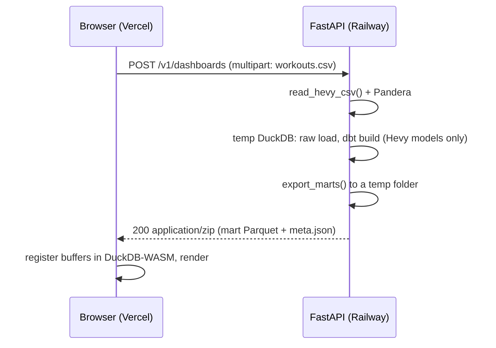

# Phase 2: "Upload your Hevy CSV" API

Status: planned, not built.

## Goal

Let a visitor upload their own Hevy CSV on the live demo and see their dashboard, without an account and without storing their data.

## Shape

The dashboard already reads Parquet buffers, so the only front-end change is a file input and a code path that registers the returned files instead of fetching `/data/*.parquet`.

## Endpoint

| | |
| --- | --- |
| `POST /v1/dashboards` | `multipart/form-data`, field `file`, max 10 MB |
| `200` | `application/zip` containing the mart Parquet files and `meta.json` |
| `400` | Not a Hevy export (`HevyFormatError` message, including the failing row) |
| `413` | File too large |
| `429` | Rate limit (per IP, e.g. 10 per hour) |
| `GET /healthz` | Liveness |

## Implementation notes

* **Reuse, do not fork.** The handler calls `liftpipe.ingest.hevy_csv.read_hevy_csv`, `liftpipe.ingest.raw_store.persist` and `liftpipe.export.export_marts`, and runs dbt with `dbtRunner` against a per-request DuckDB file in a `TemporaryDirectory`.
* **Hevy-only selection.** Run `dbt build --select +mart_weekly_muscle_volume +mart_exercise_e1rm +mart_pr_history +mart_training_consistency`; Apple Health models are skipped and the Apple sources are created empty so `fct_workouts` still builds.
* **Pre-parsed manifest.** Bake `dbt parse` into the image so a request does not pay the parse cost; expected latency for a three-year export (about 20,000 sets) is a few seconds.
* **Privacy.** Nothing is written outside the temporary directory, which is removed when the response is sent. No logging of file contents. State this on the upload form.
* **Limits.** One request at a time per worker (DuckDB plus dbt are CPU-bound); scale with Railway replicas rather than threads. Reject files over 10 MB before parsing.
* **CORS.** Allow only the Vercel domain.

## Testing

* Contract tests with FastAPI's `TestClient`: valid synthetic CSV returns a zip with every expected table; a Strong export returns `400`; an oversize file returns `413`.
* CI builds the Docker image and runs the contract tests against it.

## Open questions

* Whether to return Parquet or JSON. Parquet keeps the dashboard code path identical and is smaller; JSON would allow a non-WASM fallback.
* Whether imperial-unit accounts need a unit toggle in the UI; the parser already converts `weight_lbs` to kg.
